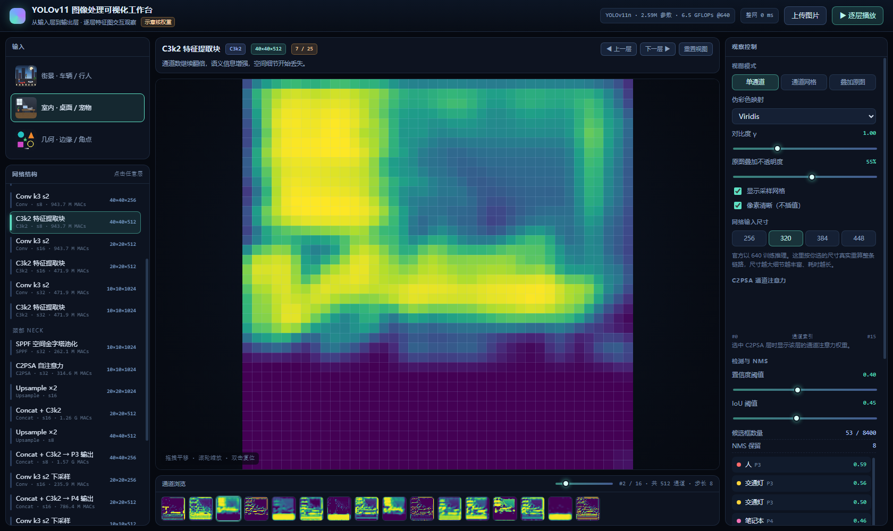
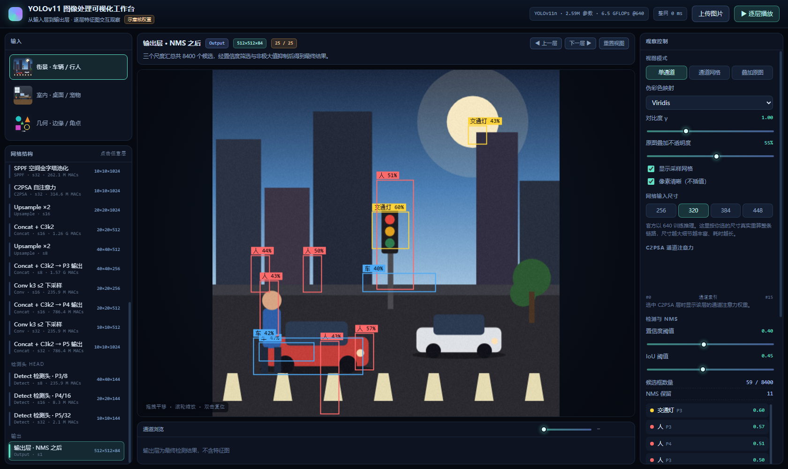

# YOLOv11 图像处理可视化工作台

把「黑箱」拆开给你看：从输入图像进入网络，到 NMS 输出最终检测框，
**每一层张量的形状变化与特征图**都在网页上逐层呈现，并且可以点击、拖拽、拖动滑块实时互动。

```
双击 index.html 即可运行（零依赖、纯离线、无需 Node / 无需联网）
```



> 上：主干 C3k2 层（40×40×512）的单通道特征图；下：输出层的 NMS 检测结果。



---

## 1. 它做了什么

| 能力 | 说明 |
| --- | --- |
| 逐层展开 | 25 个阶段：输入 → 预处理 → 主干 Backbone → SPPF / C2PSA → 颈部 PAN-FPN → 三个检测头 → NMS 输出 |
| 真实计算 | 每层特征图都是对上一层做**真实的卷积 / 最大池化 / 上采样 / 通道拼接**得到的，不是贴图 |
| 通道浏览 | 每层抽取 16 个通道，可缩略图浏览、滑块扫描、网格并列对比 |
| 尺度可视化 | 10×10 / 20×20 / 40×40 / 80×80 / 160×160 的真实降采样，可叠加采样网格与格点坐标 |
| 注意力 | C2PSA 层按通道计算注意力权重并回乘特征，右侧给出权重分布条 |
| 交互检测 | 拖动置信度 / IoU 滑块，实时重跑筛选与 NMS，框的数量与位置随之变化 |
| 跨层联动 | 悬停检测结果 → 在对应检测头尺度上高亮命中的格点区域 |
| 张量读数 | 每层的 `W×H×C`、下采样步长、MACs 估算、累计占比、整条链路耗时 |

---

## 2. 真实 vs 示意（重要）

这个工具的定位是**结构与流程的可视化教具**，不是推理引擎。请看这张对照表：

| 项目 | 是否真实 |
| --- | --- |
| 网络拓扑、层类型顺序、通道数、下采样步长 | ✅ 与 Ultralytics `yolo11.yaml`（n 尺度）一致 |
| 特征图的空间尺寸（P1/2 … P5/32） | ✅ 真实 |
| 卷积 / 池化 / 上采样 / 拼接 等算子 | ✅ 真实实现（纯 JS） |
| 特征图的像素值 | ⚠️ 由**人工设计的固定卷积核**算出，不是训练权重 |
| 通道注意力权重 | ⚠️ 由真实的通道统计量 + 固定小 MLP 算出 |
| 检测框位置与数量 | ⚠️ 多尺度显著度极大值 + 真实 NMS，位置随图像真实变化 |
| 类别标签与置信度 | ⚠️ 颜色 / 长宽比 / 尺度等启发式规则推断 |

也就是说：**形状、流程、交互是真的；数值与语义是示意**。界面上所有示意部分都带了「示意核权重」标记。

### 想换成真实权重？

把 `js/pipeline.js` 里的 `channelsFromFeatures()`（人工核混合）替换成真实前向即可，其余部分不用动：

1. 用 `onnxruntime-web` 加载 `yolo11n.onnx`
2. 把中间层张量名字加入 `graph.output`（改一下 ONNX protobuf），一次推理就能拿到所有中间层
3. `channelsFromFeatures()` 的产物直接换成真实张量，`render.js` / `app.js` 无需改动

（当前环境无法访问 CDN，因此 v1 没有内置 ONNX 路径；离线可用的示意版反而更适合当教学 demo。）

---

## 3. 怎么用

### 运行

- **最简单**：双击 `index.html`
- **推荐**（避免个别浏览器对 `file://` 的限制）：
  ```bash
  cd Visualize
  python -m http.server 8000
  # 浏览器打开 http://localhost:8000/
  ```

### 交互

| 操作 | 效果 |
| --- | --- |
| 点击左侧结构图任意一层 | 跳转到该层，画布切换为该层特征图 |
| 拖拽画布 | 平移；滚轮缩放；双击复位 |
| 拖动「通道浏览」滑块 / 点击缩略图 | 切换通道 |
| 视图模式：单通道 / 通道网格 / 叠加原图 | 网格看 16 通道全貌，叠加看激活落在原图哪里 |
| 伪彩色映射 + 对比度 γ | 换配色 / 拉对比度 |
| 网络输入尺寸 256/320/384/448 | **真实重算整条链路** |
| 置信度 / IoU 阈值 | 实时重跑筛选与 NMS |
| 悬停右侧检测结果 | 高亮对应检测头上的格点 |
| `▶ 逐层播放` / `←` `→` / `空格` | 自动逐层播放、前后翻层、播放暂停 |
| 上传图片 / 拖拽图片到画布 | 用自己的图跑整条链路 |

### URL 参数（方便分享与自动化截图）

```
index.html?stage=12&view=grid&cmap=inferno&channel=3&base=384&conf=0.5&debug=1
```

`stage` 层序号 · `view` single|grid|overlay · `cmap` viridis|inferno|turbo|ice|gray ·
`channel` 通道号 · `base` 输入尺寸 · `conf`/`iou` 阈值 · `sample` 示例编号 · `debug=1` 显示自检信息

---

## 4. 目录结构

```
Visualize/
├─ index.html          页面骨架
├─ styles.css          深色实验室风格样式
├─ js/
│  ├─ kernels.js       基础算子：3×3 卷积 / 池化 / 重采样 / 色彩映射 / 归一化
│  ├─ samples.js       3 个内置示例场景（Canvas 现场绘制，无外部图片）
│  ├─ detector.js      显著度 → 多尺度候选框 → 真实 NMS（检测头与输出层）
│  ├─ pipeline.js      YOLOv11 结构表 + 逐层前向计算（核心）
│  ├─ render.js        画布查看器：缩放 / 平移 / 网格 / 标注
│  └─ app.js           状态机、控件绑定、渲染调度
├─ tools/shot.ps1      开发辅助：无头 Edge 截图 / 导出 DOM
└─ shots/              截图输出（可删）
```

## 5. 性能

| 输入尺寸 | 整条链路耗时（纯 JS 单线程，实测参考） |
| --- | --- |
| 256 | ≈ 0.4 s |
| 320（默认） | ≈ 0.6 s |
| 448 | ≈ 1.0 s |

计算量集中在第一个 `Conv k3 s2` 层（分辨率最高、通道混合最多），越深的层越便宜。
每层特征图算完即缓存，切换层和调滑块不会重算网络；只有改「输入尺寸」或换图才会重跑整条链路。
