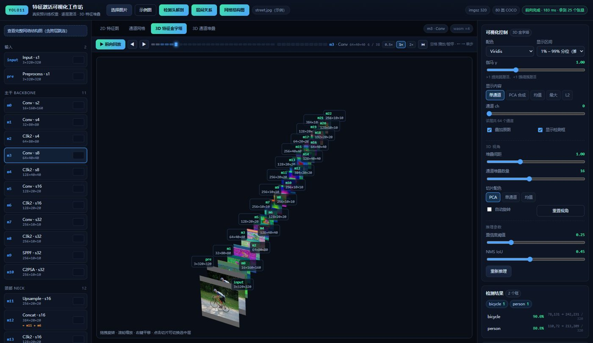
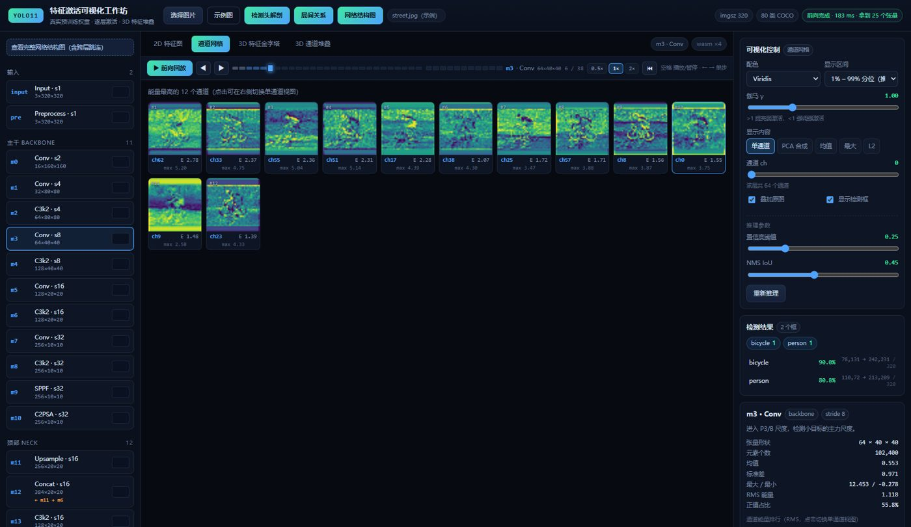
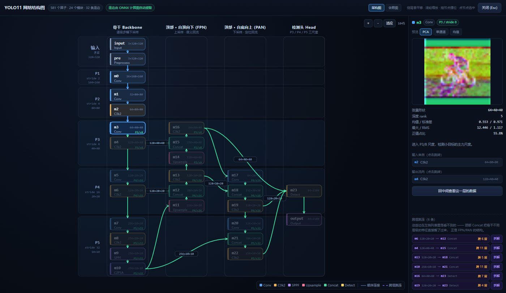
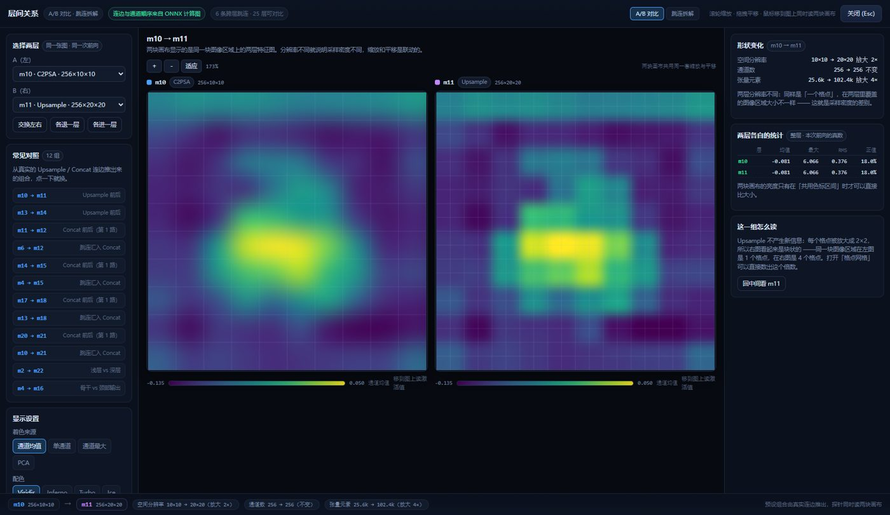
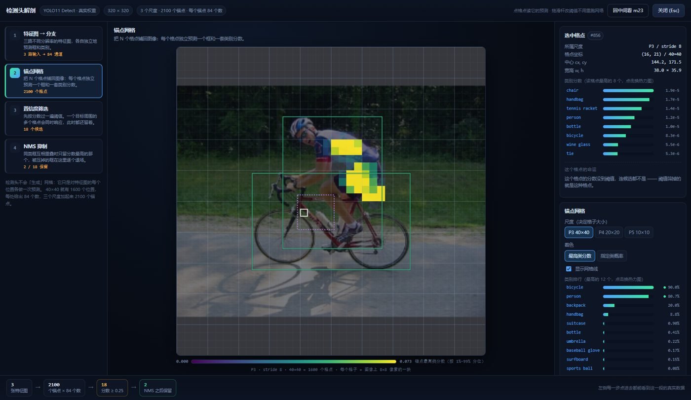
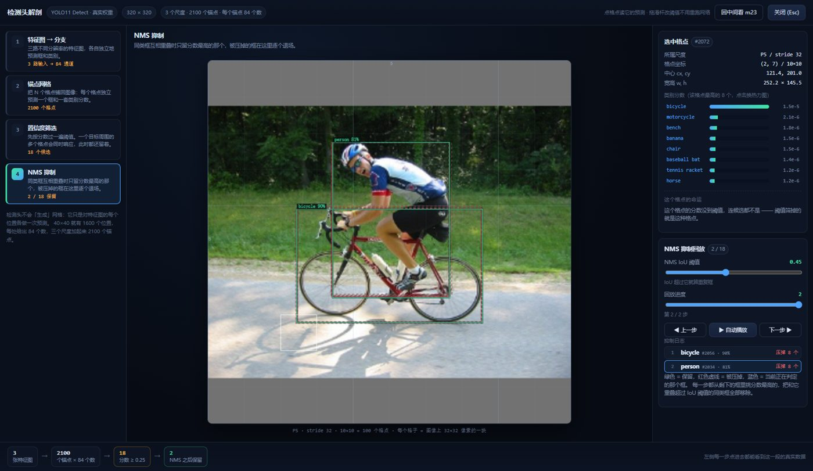
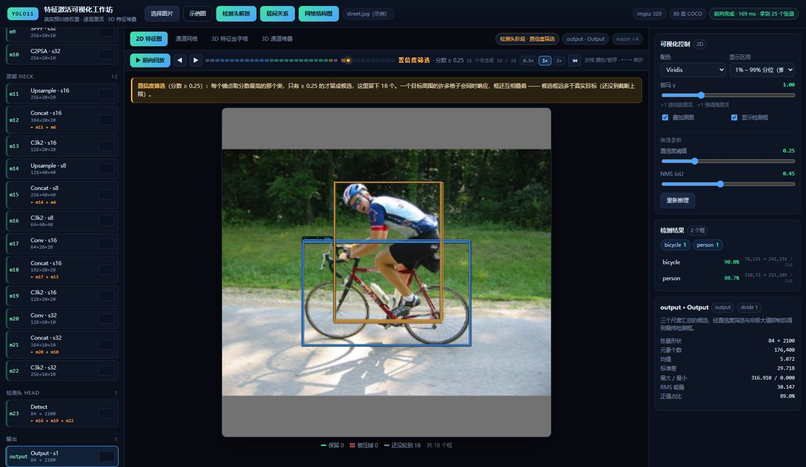
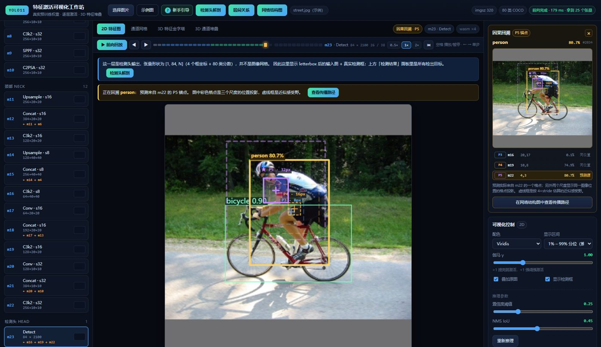
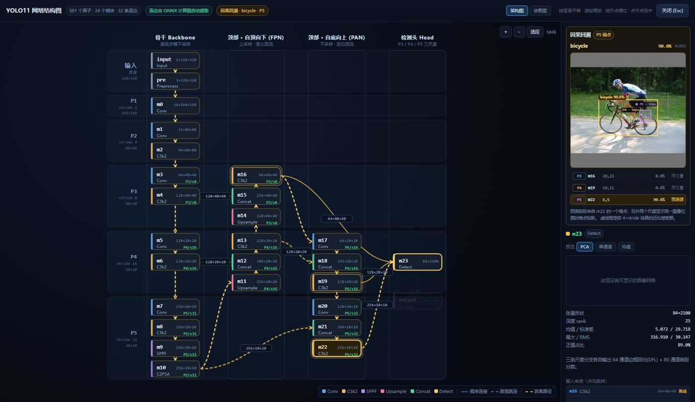
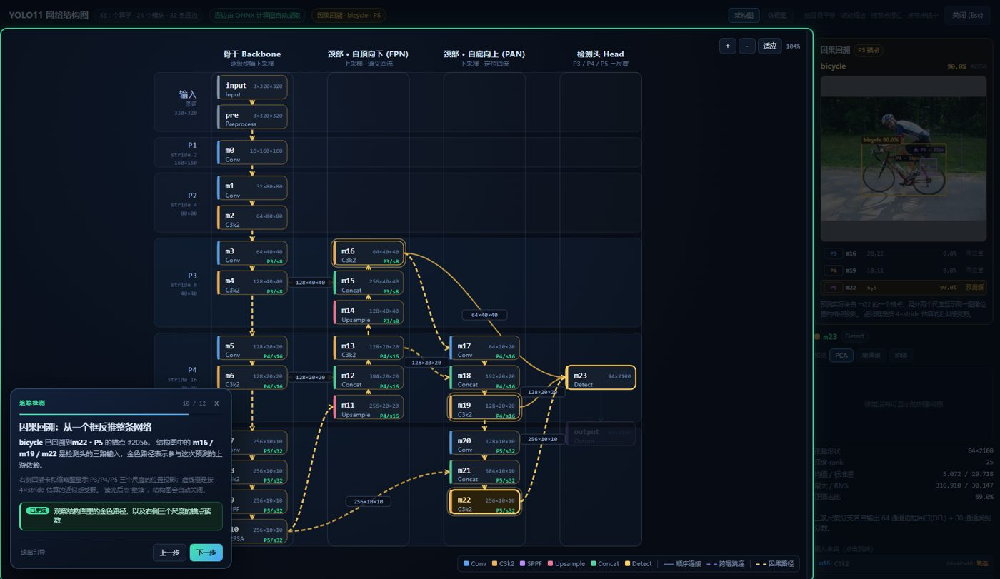

::: {.cover}
::: {.cover-kicker}
AI 驱动的高交互教育与可视化 · 参赛技术文档
:::

# YOLO11 特征激活可视化工作坊

::: {.subtitle}
把一次真实 ONNX 前向传播，变成可操作、可比较、可回溯的深度学习课堂
:::

::: {.cover-meta}
|  |  |
| --- | --- |
| **作品名称** | YOLO11 Feature Activation Visualizer |
| **参赛赛道** | AI 驱动的高交互教育与可视化 |
| **技术栈** | React 19 · Three.js · Canvas / SVG · onnxruntime-web WASM |
| **团队成员** | 袁子豪 |
| **所属学校** | 西安交通大学 |
| **提交日期** | 2026 年 11 月 4 日 |
:::

::: {.cover-note}
文档版本 1.0 · 仓库与演示视频见提交清单
:::
:::

# 摘要

::: {.abstract}

本项目面向“AI 驱动的高交互教育与可视化”赛道，把 YOLO11 的图像处理过程从论文中的方框图，转化为浏览器内可操作的实时工作台。系统不播放预制演示，而是在本地加载 `yolo11n` ONNX 权重，通过 onnxruntime-web WebAssembly Worker 执行真实前向，公开中间层激活、网络拓扑、检测头解码与 NMS 结果。学习者可以点选 27 个阶段、比较层间关系、拖动检测阈值、播放从输入到检测头的链路，并从任意检测框反查 P3/P4/P5 锚点及 `m16/m19/m22 → 颈部 → 骨干` 的上游路径。

项目的核心不是“把更多图放到网页上”，而是建立一条可验证的学习闭环：**操作产生真实状态，真实状态驱动解释，解释再被数值和路径证据约束**。配套的 12 步新手引导要求学习者完成点击、悬停和参数修改，而不是机械翻页；因果回溯明确区分真实锚点、同位置投影与 `4 × stride` 近似感受野；AI 协同过程保留细粒度 Git 提交、Prompt 快照和自动探针，避免把“看起来像”误当成“模型真实发生”。

:::

::: {.keywords}
**关键词：**YOLO11；ONNX；可交互可视化；因果回溯；新手引导；AI 协同；可复现性
:::

## 目录

::: {.toc}
- **1. 项目定位与问题**
- **2. 学习路径与功能设计**
- **3. 意图控制策略**
- **4. 系统架构与工程约束**
- **5. 功能实现与界面证据**
- **6. 检测框因果回溯**
- **7. 交互式新手引导**
- **8. 可复现性论证**
- **9. AI 协同与演进记录**
- **10. 真实性边界与已知限制**
- **11. 后续演进**
- **12. 结论**
- **附录 A：命令与成功标志**
- **附录 B：模型与数据契约**
:::

# 1. 项目定位与问题

## 1.1 从“能看到”到“能解释”

YOLO11 的教学材料通常有三类：论文结构图、指标表格和最终检测截图。它们能回答“模型结构是什么”“精度多少”，却很难回答初学者真正困惑的问题：

- 输入图像经过某一层后，为什么变成了这个形状？
- 颈部为什么不是一条直线，`m6`、`m10` 为什么要跳到后面的 Concat？
- 一个检测框来自 2100 个锚点中的哪一个？另外两个尺度与它是什么关系？
- 改动置信度阈值，为什么检测框变了而特征图没变？
- 一个框从输出往回看，到底经过了哪些层？

本项目把这些问题变成可点击的界面状态。它面向课堂演示、竞赛答辩和自学者，将“抽象概念”转成“可观察变量 + 可执行操作 + 可核验数值”。

## 1.2 赛道契合度

| 赛道关注点 | 本项目的回应 |
| --- | --- |
| 借助 AI 生成前端代码 | React 19、Canvas、SVG、Three.js 与 Worker 代码均由 AI 在人类约束下迭代生成 |
| 把抽象复杂概念转成直观面板 | 27 个阶段、6 条跳连、2100 个锚点、NMS 抑制过程均有对应视图 |
| 滑块与拖拽互动 | 阈值、IoU、伽马、通道、堆叠、网络缩放/平移/节点拖拽均可操作 |
| 可解释而非播放动画 | 所有热力图、统计、框与路径都来自同一次真实前向 |
| 教育价值 | 有分层学习路径、12 步操作式引导、真实与推断的显式标注 |

## 1.3 设计原则

1. **真实性优先**：能用真实张量完成的效果，不使用示意数据。
2. **证据可追溯**：每个视图尽量能回到层名、张量形状、锚点编号或 ONNX 连边。
3. **解释与数据分离**：人工撰写的层语义、布局归档、近似感受野必须明确标注。
4. **一次推理、多视图复用**：改阈值只重算解码，不重复跑网络。
5. **先操作、后解释**：新手引导用真实状态推进，避免“读完仍不会用”。

# 2. 学习路径与功能设计

## 2.1 三类用户

| 用户 | 主要问题 | 对应入口 |
| --- | --- | --- |
| 零基础学习者 | 页面太复杂，不知道先看什么 | 新手引导、2D 热力图、预设示例图 |
| 有 CNN 基础的学生 | 层间关系、特征尺度、检测头如何工作 | 网络结构图、层间关系、检测头解剖、前向回放 |
| 教师 / 评审 | 结果是否真实、能否复现、边界是否诚实 | 真实 vs 推断表、模型契约、探针与 Git 记录 |

## 2.2 学习闭环

```text
选择一层 → 看激活与统计 → 调参数验证“改了什么” → 打开结构图看它从哪里来
        → 打开层间关系比较相邻/跨层张量 → 播放整条链路 → 点一个检测框反查原因
```

这条路径刻意避免一开始就展示所有信息。新手引导先建立界面地图，再进入单层、3D、结构、检测头与回溯；每一步只引入一个心智模型。

## 2.3 功能矩阵

| 模块 | 回答的问题 | 真实数据来源 | 关键交互 |
| --- | --- | --- | --- |
| 2D 特征图 | 这一层在哪些位置响应强？ | 中间层张量 | 悬停读数、配色、伽马、区间 |
| 通道网格 | 哪些通道能量最高？ | 通道 RMS | 点击通道 |
| 3D 金字塔 | 全网分辨率与通道规模如何变化？ | 各层张量摘要 | 旋转、缩放、点切片 |
| 3D 通道堆叠 | 单层通道如何形成“地形”？ | 通道激活 | 间距、数量、视角 |
| 网络结构图 | 层的真实上下游和跳连是什么？ | `graph.json`（ONNX 提取） | 缩放、平移、拖节点、选层 |
| 层间关系 | Upsample/Concat 前后如何变化？ | 两层真实激活 | 同步缩放/平移/探针、跳连拆解 |
| 检测头解剖 | 特征图如何变成锚点、分类与框？ | `output0` | 点格点、阈值、NMS 单步/播放 |
| 前向回放 | 整条处理链如何走一遍？ | 层清单 + 本次输出 | 时间轴、倍速、键鼠、左列表同步 |
| 因果回溯 | 某个框由哪些尺度和层产生？ | `anchor + output0 + graph` | 点框、三尺度锚点、路径高亮 |
| 新手引导 | 我该怎样主动使用这些功能？ | 真实 UI 状态 | 聚光灯、任务动作、跳过/复习 |

# 3. 意图控制策略

## 3.1 核心问题：AI 很容易生成“看起来合理”的可视化

大模型可以迅速写出漂亮页面，但也容易产生四类偏差：

1. 把示意图当作模型输出；
2. 把人工猜测的路径写成“真实依赖”；
3. 为了让动画顺畅而改写真实顺序；
4. 只验证“能构建”，不验证“数据与交互正确”。

因此，本项目没有使用“帮我做一个 YOLO 可视化网站”这类宽泛 Prompt，而是把每次需求拆成 **事实约束、范围约束、验收条件、回归条件** 四层。

## 3.2 Prompt 结构模板

```text
[目标] 用户要完成的学习任务，而不是要画的 UI。
[仓库事实] 已有组件、数据字段、模型输出、禁止重复实现的部分。
[真实性约束] 哪些量必须来自 ONNX/张量；哪些是近似值，必须如何标注。
[范围约束] 允许改哪些文件；不引入后端、不新增密钥、不重导出模型（除非明确要求）。
[交互验收] 用户必须能完成哪些动作；状态变化如何观察。
[回归验收] 原有结构图/回放/检测结果必须保持什么行为。
[证据] 构建、无头浏览器探针、截图、控制台错误与 Git 提交。
```

### 示例：因果回溯的受控 Prompt

原始需求只有一句“点击检测框，高亮 P3/P4/P5 与传播路径”。在实施时被拆成以下可验证约束：

- 真实来源必须使用 `output0` 对应的 `anchor` 与 `classId`，不能重新推理；
- 三个尺度必须使用统一的 offset 与行优先展平；
- 真实预测源和其余两个尺度的同位置投影要分色、分文案；
- 结构图使用 ONNX 上游遍历，不能手写一条“m16 → m22 → m23”的假链；
- 近似感受野必须标注为 `4 × stride` 估算；
- 点击画布、点击列表、关闭结构图、换图、阈值变化都要有明确状态；
- 最后用无头浏览器验证 `m16/m19/m22` 三节点与 31 条边。

## 3.3 上下文控制

每次迭代先让 AI 读取事实源，再允许改代码：

| 事实源 | 作用 |
| --- | --- |
| `public/models/layers.json` | 27 个阶段、张量名、stride、分组、人工说明 |
| `public/models/graph.json` | 真实节点、32 条边、6 条跳连、张量形状 |
| `src/model/headAnatomy.js` | P3/P4/P5 网格、offset、锚点换算 |
| `src/model/detect.js` | 主界面与解剖页共享的解码与 NMS |
| `tools/probe-*.mjs` | 可执行的界面验收，而非口头保证 |

这种“先读契约、再写实现”的上下文设计，减少了 AI 自行发明层名、张量维度或连边的概率。

## 3.4 验收与 Bug 修复闭环

| 阶段 | 人的动作 | AI 的动作 | 可核验产物 |
| --- | --- | --- | --- |
| 需求 | 描述学习目标与失败现象 | 检索仓库、提出方案 | 修改建议、影响文件 |
| 实现 | 限定数据源与范围 | 写组件、数据层、样式 | Git diff |
| 自检 | 要求真实浏览器操作 | 启动 dev、运行 Puppeteer | 截图、控制台、断言 |
| 纠错 | 指出“文字仍被选中”“回溯未进引导” | 找根因、修补、再回归 | Bug 修复提交 |
| 固化 | 决定是否提交 | 更新 README 与测试入口 | 细粒度 commit |

两个真实案例体现了这一闭环：结构图拖拽选中文字时，AI 没有只加一句 CSS，而是同时处理指针默认行为、SVG 文本命中与原生拖拽；因果回溯未进入引导时，AI 先核查 11 步定义，再加入第 10 步，测试后又发现状态残留并补充清理。

## 3.5 人工职责与 AI 职责

- **人**：确定教学目标、真实性边界、优先级，判断“这个效果是否真的有解释价值”，发现异常并要求复现。
- **AI**：快速阅读仓库、生成候选实现、补充测试、定位工具链问题、批量更新文档。
- **共同**：以可执行探针和 Git diff 作为事实，而不是以对话中的自信语气作为事实。

# 4. 系统架构与工程约束

## 4.1 总体架构

系统是纯静态前端：没有业务后端、数据库、账号系统或 API Key。模型、示例图片、层清单、结构图和 WebAssembly 运行时都在本地资产目录中。

```text
┌──────────────────────────── Browser ────────────────────────────┐
│ React 19 工作台                                                  │
│  ├─ Pipeline / Viewport / Control / Detection / Stats            │
│  ├─ Structure / Relations / HeadAnatomy / GuidedTour             │
│  └─ CausalTracePanel + SVG/Canvas overlay                        │
│            │                                                     │
│            ├─ 派生状态：shape / stats / dets / replay / trace     │
│            │                                                     │
│            ▼                                                     │
│      WorkerSession ── postMessage ──► Web Worker                 │
│                                      └─ onnxruntime-web WASM     │
│                                           └─ yolo11n_vis.onnx     │
│            ▲                                                     │
│            └─ 25 个输出张量（含 output0 与中间层）                 │
└──────────────────────────────────────────────────────────────────┘
```

## 4.2 技术选型与理由

| 层次 | 选型 | 理由与约束 |
| --- | --- | --- |
| 构建 | Vite 8 | 启动快、ESM Worker 支持好；`base: './'` 便于静态部署 |
| UI | React 19 | 适合多浮层、共享状态与派生数据；不引入重型 UI 框架 |
| 2D | Canvas 2D | 像素级热力图、框、探针与叠加层性能更可控 |
| 拓扑 | SVG + Pointer Events | 节点可点击/拖动，连边可用 marker 与路径动画 |
| 3D | Three.js | 特征金字塔、通道地形与相机交互 |
| 推理 | onnxruntime-web 1.30 | 浏览器内 WASM，无需服务端；CPU 可复现性高 |
| 并发 | Module Web Worker | 避免推理阻塞 UI；Worker 失败时主线程兜底 |
| 验证 | Puppeteer Core + Edge | 真实点击、真实 Canvas、真实控制台检查 |

## 4.3 推理数据流

1. 图像经 `letterbox` 等比缩放并填充 114 灰边到 `320 × 320`；
2. RGB 像素归一化为 `Float32Array`，形状 `[1, 3, 320, 320]`；
3. Worker 调用 ONNX Runtime，一次返回 25 个张量；
4. 主线程保存输出，派生出形状、层统计、通道能量、检测框、重放阶段与回溯模型；
5. 各视图只消费派生数据，避免重复推理。

`App.jsx` 是状态编排层，而不是算法实现层。检测解码、锚点映射、结构路径、层间关系分别放在 `src/model/`，渲染放在 `src/viz/` 与 `src/components/`。这样做使 AI 修改某一模块时不必触碰整页。

## 4.4 模块职责

| 目录 / 文件 | 职责 |
| --- | --- |
| `src/App.jsx` | 应用状态、推理生命周期、浮层入口、派生数据编排 |
| `src/model/preprocess.js` | letterbox、NCHW、坐标反变换 |
| `src/model/runner.js` / `ortWorker.js` / `session.js` | WASM 会话、Worker 协议、主线程兜底 |
| `src/model/detect.js` | 候选解码、逐类 NMS、类别直方图 |
| `src/model/headAnatomy.js` | 三尺度网格、锚点换算、单格读数 |
| `src/model/causalTrace.js` | 真实锚点、投影、上游路径模型 |
| `src/model/relations.js` | 跳连、Concat 通道段、段能量与差值 |
| `src/model/headReplay.js` | 检测头回放阶段构造 |
| `src/state/graphLayout.js` | 依赖图/架构图布局、路径遍历、边路由 |
| `src/viz/` | Canvas、SVG、Three.js 渲染与探针 |
| `src/components/` | 工作台面板、全屏浮层、引导任务卡 |

## 4.5 关键状态与不变量

| 状态 | 不变量 |
| --- | --- |
| `result.map.output0` | 形状 `[1, 84, 2100]`；DFL 已在导出时解码 |
| `dets` | 只由 `output0 + conf + iou` 派生；改阈值不重跑网络 |
| `selectedDetKey` | 由 `classId + anchor` 唯一标识；换图或结果失效时清除 |
| `causalTrace` | 必须有检测与结构图；无图时不伪造路径 |
| `replay` | 层阶段按讲解顺序，检测头阶段使用同一份 `output0` |
| `graph` | 连边来自 ONNX；节点位置来自人工语义布局 |

## 4.6 性能与部署约束

- 实测一次前向约 165–183 ms（CPU / WASM，示例图，320 输入）；
- 推理放 Worker，UI 动画与 Canvas 不等待主线程；
- ORT 优先 4 线程，SharedArrayBuffer 不可用时自动退回单线程；
- Vite dev/preview 设置 COOP/COEP，生产静态托管若无法设头则走单线程兜底；
- 模型约 10 MB，`public/ort` 约 82 MB 且由 `postinstall` 生成，不入 Git；
- 3D 视图按需旋转与重绘，但共享同一组张量，不复制整网激活。

## 4.7 如何约束 AI 生成架构

1. 明确“数据层 / 渲染层 / 编排层”边界，禁止把解码逻辑复制到组件内；
2. 检测头解剖与主界面必须共享 `decodeCandidates` / `nmsTrace`；
3. 结构图、层间关系、因果回溯统一使用 `graph.json` 与 `ancestorsOf`；
4. 新增全屏视图必须遵守现有浮层、`Esc`、关闭回落的交互约定；
5. 新增“真实”断言必须给出数据来源；无法证明的内容只能标记为解释或近似；
6. 每个核心模块至少具备构建检查和一个可执行探针。

# 5. 功能实现与界面证据

## 5.1 单层特征与 3D 视图

主工作台左侧按 Backbone / Neck / Head 分组展示 27 个检查点。点选任意层后，中间可以切换 2D 特征图、通道网格、3D 特征金字塔与 3D 通道堆叠。2D 视图支持单通道、PCA 三通道、均值、最大、L2、原图 RGB 等模式，并可在原图上叠加检测框；鼠标悬停读取真实激活值。

::: {.figure-pair}



:::

3D 视图不是装饰：金字塔的高度与切片尺寸对应真实张量。它帮助学习者建立“浅层大而少、深层小而多”的尺度感，再回到 2D 看具体激活。

## 5.2 真实 ONNX 网络结构图

结构图由 `tools/export_graph.py` 解析 581 个 ONNX 算子，按模块前缀归并为 24 个模块，再补上输入/预处理/输出三个 UI 节点，形成 27 个节点、32 条边。6 条跨层跳连不是手工声明，而是外部张量依赖自动解析的结果。



界面提供两种布局：

- **架构图**：按分辨率带与处理阶段排列，颈部呈 U 形，适合讲 FPN/PAN；
- **依赖图**：按最长路径 rank 分三行，适合快速总览。

交互包括滚轮缩放、拖背景平移、拖节点摆位、点节点选层、查看输入来源与输出去向。拖拽期间禁用文本选择与原生拖拽，箭头使用固定尺寸的圆角开放式 marker，而不是随线宽放大的三角块。

## 5.3 层间关系：A/B 对比与跳连拆解

“单层热力图”回答这一层长什么样，“层间关系”回答两层如何交互。A/B 模式的两块画布共用缩放、平移与探针，适合观察 `m10 → m11` 的 Upsample 与 `m6/m11 → m12` 的 Concat。



跳连拆解进一步利用 ONNX 输入顺序，算出目标层中哪一段通道来自源层，并用逐元素差验证“Concat 只搬运、不计算”。当输入空间尺寸不同或通道数不守恒时，界面明确显示“拆不开”，而不是画出没有依据的差异图。

## 5.4 检测头解剖

检测头解剖把 `output0` 拆成四步：分支构成 → 锚点网格 → 置信度筛选 → NMS。

::: {.figure-pair}



:::

该页与主界面共用 `decodeCandidates` / `nmsTrace`，因此“解剖页的框”和“主界面的框”不是两套算法。改变阈值只触发解码重算；候选按分数截断在 300 个，避免在极低阈值下列出全部格点。

## 5.5 前向回放

回放条从 `input` 走到 `output`，再进入检测头的锚点、候选框与 NMS 阶段。播放时左侧流水线同步高亮并滚动到当前层，走过的层保留轨迹。支持 0.5×/1×/2×、单步、回到起点、点击时间轴跳转，以及空格/方向键。



需要强调：层阶段顺序来自 `layers.json` 的讲解顺序，不等于硬件上的严格执行时序；真实分支关系要看结构图与层间关系。检测头阶段是同一份 `output0` 的“解码加演”，不会重新推理。

# 6. 检测框因果回溯

## 6.1 学习问题

普通检测结果只显示类别、分数与框。学习者无法知道：这个框由哪个尺度预测？它的锚点在哪？另外两个尺度为什么也会被标出？从输出回看，信号经过了哪些层？因果回溯把“结果”与“产生结果的结构”连起来。

## 6.2 三个尺度的坐标映射

320 输入的检测头输出为 `[1, 84, 2100]`。2100 不是任意数字，而是三个尺度按行优先拼接：

```text
P3 / stride 8 : 40 × 40 = 1600 个锚点，offset = 0
P4 / stride 16: 20 × 20 =  400 个锚点，offset = 1600
P5 / stride 32: 10 × 10 =  100 个锚点，offset = 2000
                                        总计 2100
```

给定检测框 `d`，真实预测源由 `d.anchor` 决定：

```text
所属尺度 s = 满足 offset_s ≤ anchor < offset_s + count_s 的网格
局部下标 k = anchor − offset_s
gx = k mod grid_width
gy = floor(k / grid_width)
像素中心 = ((gx + 0.5) × stride, (gy + 0.5) × stride)
```

如果直接预测源属于 P5，P3/P4 仍会按框中心投影到对应尺度的格点，但会明确标记为“同位置投影”，而不是“实际预测源”。这样既展示多尺度分工，也不把投影伪装成真实命中。

## 6.3 从锚点到整条网络

结构图以 `m23` Detect 为根，使用 `ancestorsOf('m23', edges)` 求所有能到达根节点的节点与连边。三路检测头输入 `m16 (P3)`、`m19 (P4)`、`m22 (P5)` 都会出现在上游集合中；再根据真实来源分支计算 `primaryNodeIds` / `primaryEdgeKeys`，让主路径更亮，其余上游路径降权。

```text
输入图锚点与近似感受野
        │
        ├─ P3 投影 ─ m16 ─┐
        ├─ P4 投影 ─ m19 ─┼─ m23 Detect ─ 检测框
        └─ P5 真源 ─ m22 ─┘
                         ↑
                  颈部 FPN / PAN
                         ↑
                  骨干 Backbone
```

这里的高亮不是“三路都真实参与同一个框”：Detect 的解耦头让每个框由一个尺度上的一个锚点直接预测；另外两个尺度展示的是同图像位置的多尺度上下文。文案、颜色与路径明暗共同表达这一区分。

::: {.figure-pair}



:::

## 6.4 近似感受野的诚实口径

界面使用 `RF ≈ 4 × stride`：

| 尺度 | stride | 近似感受野边长（320 输入） |
| --- | --- | --- |
| P3 | 8 | 32 px |
| P4 | 16 | 64 px |
| P5 | 32 | 128 px |

它不是逐层卷积核递推得到的严格理论感受野，也不是可加性解释。它的用途是让初学者直观看到“深层锚点对应更大的图像区域”。这个限制同时写在界面提示、README 和技术报告中。

## 6.5 状态生命周期

1. 点击 2D 画布中的检测框，或点击右侧检测结果行，设置 `selectedDetKey`；
2. `selectedDet` 从当前阈值下的 `dets` 中查找，避免使用过期框；
3. `buildCausalTrace` 生成锚点、分数、节点集合与边集合；
4. 检测结果列表、主画布、结构图、回溯卡共享同一 `causalTrace`；
5. 打开结构图时保持选中；关闭结构图后主画布仍保留标记；
6. 点击空白处、点击清除、换图、重跑结果或框因阈值变化消失时，状态自动失效；
7. 引导离开第 10 步时主动清理，避免污染下一步回放。

## 6.6 一次真实样本

使用示例图与默认阈值，点击 `bicycle` 框得到：

| 观测项 | 值 |
| --- | --- |
| 实际预测源 | `m22 · P5` |
| 全局锚点编号 | `#2056` |
| P3 / P4 / P5 格点 | 约 `(20,22)` / `(10,11)` / `(6,5)` |
| P5 同类分数 | 90% |
| 点亮上游边 | 31 条 |
| 浏览器错误 | 无 |

`#2056` 落在 P5 区间 `[2000, 2100)`，局部下标 `56`，对应 `gx=6, gy=5`，与表中一致。这说明回溯使用的是真实解码锚点，而不是按屏幕坐标重新猜一个格点。

# 7. 交互式新手引导

## 7.1 设计目标

传统产品引导常用“遮罩 + 下一步”，用户读完仍不知道控件在哪，也不知道自己的操作是否生效。本项目将引导定义为 **可执行的教练层**：每一步绑定真实控件，完成条件读取应用状态，只有发生正确变化才允许继续。



## 7.2 12 步任务结构

| 步骤 | 章节 | 学习者动作 | 完成条件示例 |
| --- | --- | --- | --- |
| 1–2 | 起点 / 界面地图 | 认识真实前向、顶栏与状态 | 阅读后继续 |
| 3 | 读懂单层 | 点击 `m12` | `selId === 'm12'` |
| 4 | 读懂单层 | 在热力图上移动 | 收到 `pointermove` |
| 5 | 读懂单层 | 修改配色 | 控件 `change` 事件 |
| 6 | 读懂单层 | 切到 3D 金字塔 | `view === 'pyramid'` |
| 7 | 深入网络 | 打开结构图并观察 | `structureOpen` |
| 8 | 深入网络 | 打开层间关系 | `relOpen` |
| 9 | 追踪检测 | 打开检测头解剖 | `headOpen` |
| 10 | 追踪检测 | 点击任意检测框 | `traceActive === true` |
| 11 | 追踪检测 | 启动前向回放 | `replayPlaying === true` |
| 12 | 完成 | 总结三条使用路径 | 完成导览 |

## 7.3 聚光灯与任务卡布局

引导读取目标元素的 `getBoundingClientRect()`，在四边绘制暗色遮罩，中央挖出高亮区域；任务卡根据目标所在位置选择 `top/bottom/left/right/corner`，并在窗口边缘自动夹紧。目标滚动或窗口变化时重新测量，避免卡片挡住被讲解的控件。

## 7.4 全屏视图的观察模式

结构图、层间关系与检测头解剖是整屏浮层。引导不强迫用户关闭后继续，而是允许浮层打开，并把任务卡移到角落：

- 进入该步时，如果尚未打开，提示点击顶栏入口；
- 打开后，`target` 切换为全屏视图的中心区域；
- 文案从“如何打开”切换为“应该观察什么”；
- 离开该步时自动关闭浮层，避免下一任务从错误页面开始；
- 因果回溯离开时还清除回溯状态，保证回放从干净状态启动。

## 7.5 因果回溯为什么必须进入引导

因果回溯是连接“检测结果”与“网络结构”的关键桥。如果初学者只学会播放回放，仍然不会反查原因。第 10 步因此放在检测头解剖之后、前向回放之前：

1. 先知道检测头产生框；
2. 再点击一个真实框，看到三尺度锚点与路径；
3. 最后播放整条链路，把局部回溯放回全局流程。

该步骤曾经缺失。交付前的检查 Prompt 是“因果回溯功能是否加载到了之前做的引导部分”，AI 核查后确认没有，才补为第 10 步。这不是事后补文案，而是功能验收发现了教学路径的断点。

## 7.6 完成、跳过与复习

- 支持上一步、跳过本步、退出和 `Esc`；
- 跳过不会伪造完成条件，只推进当前步骤；
- 完成后写入 `localStorage`，入口变为“复习引导”；
- 引导不阻断键盘快捷键，但在输入框聚焦或浮层打开时避免抢占；
- 任何步骤都可以退出，不把用户困在流程中。

# 8. 可复现性论证

## 8.1 复现边界

本项目将“运行所需”和“重新生成模型所需”分开：

- **普通复现**只需要 Node.js、浏览器和仓库内资产；不需要 Python、CUDA、API Key 或后端服务；
- **重新导出 ONNX**才需要 Python 3.12、PyTorch、Ultralytics、ONNX 与 ONNX Runtime；
- 模型、`layers.json`、`graph.json`、示例图片已经入库，因此 10 分钟路线不会触发模型训练或导出。

## 8.2 环境清单

| 项目 | 要求 | 实测 |
| --- | --- | --- |
| 操作系统 | Windows / macOS / Linux | Windows 11 |
| Node.js | ≥ 22.12.0（Vite 8、Rolldown、puppeteer-core 要求） | Node 24.21.0 |
| npm | 随 Node 提供 | npm 11.19.0 |
| 浏览器 | 支持 WebAssembly 的现代 Chromium / Firefox | Microsoft Edge |
| 内存 | 建议 ≥ 4 GB | — |
| GPU | 不需要 | CPU WASM |
| 环境变量 | 无 | 见 `.env.example` |

运行时依赖（锁定于 `package-lock.json`）：

```text
react 19.x / react-dom 19.x
three 0.186.x
onnxruntime-web 1.30.x
vite 8.x / @vitejs/plugin-react 6.x
puppeteer-core 25.x（仅自动化验证）
```

## 8.3 10 分钟极速复现路线

```powershell
git clone https://github.com/TrueYuanZihao/YOLOv11-Visualizer.git
cd YOLOv11-Visualizer
npm ci
npm run dev
# 浏览器打开 http://localhost:5173/
```

`npm ci` 的 `postinstall` 会运行 `tools/sync-ort.mjs`，把 `onnxruntime-web` 的 WASM 文件复制到 `public/ort/`。节点版本、版本锁定与资产位置均在 README 中给出。

| 时间 | 操作 | 预期 |
| --- | --- | --- |
| 0:00–1:00 | 安装 Node、打开终端 | `node -v`、`npm -v` 有输出 |
| 1:00–4:30 | `git clone` + `npm ci` | 依赖安装完成，`public/ort/` 生成 |
| 4:30–5:30 | `npm run dev` | 终端显示本地地址 |
| 5:30–7:00 | 打开页面，等待示例图推理 | 顶栏显示“前向完成”、约 25 个张量 |
| 7:00–9:00 | 点 `m12`、切换 2D/3D、打开结构图 | 热力图、节点、跳连可见 |
| 9:00–10:00 | 点检测框、打开引导 | 三尺度锚点、路径、12 步引导可用 |

网络首次下载依赖可能使总时长接近 10 分钟；在依赖缓存或国内镜像下通常 4–7 分钟。

## 8.4 环境变量模板

仓库提供 `.env.example`。本项目没有服务端地址、模型密钥或第三方 API：

```dotenv
# No API key or backend is required.
# Model, sample image and ONNX Runtime WASM are served from public/.
# Use CLI flags for local deployment, e.g. npm run dev -- --port 5173
```

因此不存在“缺少 API Key 导致无法复现”的外部依赖。

## 8.5 离线资产与部署

| 资产 | 位置 | 是否入库 | 说明 |
| --- | --- | --- | --- |
| ONNX 模型 | `public/models/yolo11n_vis.onnx` | 是 | 约 10 MB |
| 层清单 | `public/models/layers.json` | 是 | 27 个阶段与说明 |
| 结构图 | `public/models/graph.json` | 是 | 581 算子归并结果 |
| 示例图 | `public/samples/street.jpg` | 是 | 自动加载 |
| ORT WASM | `public/ort/` | 否 | `npm ci` 自动生成 |
| 原始权重 | `ultralytics-main/ultralytics/yolo11n.pt` | 是 | 仅重新导出时使用 |

静态部署时建议同时设置 COOP/COEP 以启用多线程；若不设置，`runner.js` 会捕获会话创建失败并自动切到单线程。`vite.config.js` 已为 dev/preview 配置响应头。

## 8.6 成功标志

1. 顶栏状态从“正在执行前向”变为“前向完成 · xxx ms · 拿到 25 个张量”；
2. 左侧 27 个阶段均有形状与 RMS 能量条；
3. 中间 2D 画布有真实热力图，右侧至少出现一个检测框；
4. 结构图显示 27 节点、32 边、6 跳连；
5. 检测头解剖显示 `1600 + 400 + 100 = 2100`；
6. 点击检测结果后 `m16/m19/m22` 均出现在结构图上游；
7. 顶栏“新手引导”可进入，并完成第 10 步因果回溯。

## 8.7 自动化探针

```powershell
npm run build
npm run probe          # 主界面四视图与控制台
npm run probe:layers   # 逐层张量与切换
npm run probe:structure
npm run probe:head
npm run probe:relations
npm run probe:replay
npm run probe:causal
```

探针不是截图脚本：它会等待真实推理完成，点击真实 DOM，读取 Canvas/SVG 状态，并收集 `pageerror` 与控制台错误。构建通过不等于功能正确，因此交付前至少同时运行构建与对应探针。

## 8.8 确定性论证

- 输入是固定示例图或用户选择的本地图，推理前没有随机采样；
- 模型权重固定，ONNX Runtime 与后端版本锁定；
- 阈值变化只重算纯函数式解码与 NMS，不重新推理；
- 结构图布局由固定节点/边输入与确定性排序得到；
- 视觉像素尺寸会随 `devicePixelRatio` 变化，但张量、检测与路径数值不随 UI 尺寸变化。

严格来说，不同 CPU / WASM 版本可能存在浮点末位差异；本报告不承诺跨平台 bitwise 完全一致，只承诺同一资产、同一版本的数值与行为可重复。

## 8.9 重新生成模型（可选）

只有修改 `imgsz`、导出更多中间张量或替换权重时才需要：

```powershell
python -m venv .venv312
.venv312\Scripts\python.exe -m pip install ultralytics onnx onnxruntime numpy
npm run export:onnx
npm run verify:onnx
npm run export:graph
```

修改 `imgsz` 会改变锚点数与网格偏移，必须同步重新生成 `layers.json`、`graph.json` 并跑检测头探针。项目默认锁定 `320`，避免模型契约漂移。

# 9. AI 协同与演进记录

## 9.1 Git 演进

仓库保留 11 次细粒度提交，每次对应一个功能模块或一次真实修复。关键节点如下：

| 提交 | 日期（2026） | 演进内容 |
| --- | --- | --- |
| `e2fbaf3` | 10-13 | 初始离线可视化版本 |
| `04841d4` | 10-14 | 真实权重 + Vite/React 重构 |
| `110cdfa` | 10-15 | ONNX 拓扑提取与结构图 |
| `eb493c6` | 10-15 | U 形架构布局 |
| `496b69b` | 10-15 | 检测头解剖 |
| `272fb15` | 10-15 | 层间关系 A/B + 跳连拆解 |
| `dc72239` | 10-16 | 前向回放 |
| `f724c88` | 10-16 | 回放检测头阶段 |
| `a51daad` | 10-20 | 新手引导 |
| `78f9baf` | 10-29 | 因果回溯、拖拽选择修复、箭头重绘 |
| `ccd49f7` | 11-02 | 因果回溯进入引导与状态清理 |

提交信息中包含对应 AI Prompt 摘要，便于从 Git 日志直接定位到对话快照。

## 9.2 Prompt 链与产物

| 快照 | 核心产物 | 关键验证 |
| --- | --- | --- |
| 网络结构 | `export_graph.py`、`GraphView`、架构布局 | 32 边、6 跳连、拖动/选择回归 |
| 检测头 | `headAnatomy`、`AnchorGrid`、共享解码 | 2100 锚点、12/12 映射断言 |
| 引导 + 回溯 | `GuidedTour`、`causalTrace`、路径渲染 | 第 10/12 步、三头节点、31 边、状态清理 |

详细原文见 `AI_PROMPT_HISTORY.md` 与 `ai-history/`。导出明确区分“原始对话文本”和“仓库演进重建”，不把缺失内容补写成原始消息。

## 9.3 AI 生成代码的可维护性

- 每个数据算法有单一入口，组件只负责消费；
- 主界面与全屏视图复用同一解码和路径函数；
- 新增视图沿用既有浮层、按钮、颜色与 `Esc` 规则；
- 关键模块有独立探针，AI 修改后必须重新运行；
- README 记录真实 vs 推断、已知限制与模型契约，防止后续迭代误用。

## 9.4 真实协同的失败与修复

项目保留了三类不顺利的过程：PowerShell 参数转义破坏 JSX、TDZ/React key 等实现错误、拖拽文本选择与引导状态残留等交互 Bug。技术文档与 Prompt 快照没有把这些过程改写成“一次成功”，因为竞赛要求展示的正是人如何引导 AI 定位和修复问题。

# 10. 真实性边界与已知限制

## 10.1 真实数据

- 中间层激活、形状、统计与热力图：真实 ONNX 前向；
- 检测框、类别、置信度：真实 `output0` 解码与 NMS；
- 结构图连边与 6 条跳连：ONNX 计算图自动提取；
- 层间 Concat 通道段：ONNX 输入顺序与真实张量差值；
- 锚点编号、三尺度 offset：`output0` 的真实索引；
- 回放检测头的候选框与抑制关系：本次输出的真实解码结果。

## 10.2 解释、近似与人工归档

- 层的自然语言说明是人工撰写；
- 架构图节点的行列位置来自 `ARCH_SLOTS` 人工语义归档；
- 近似感受野是 `4 × stride` 估算；
- 3D 的通道高度/颜色是渲染后处理，不代表统一通道语义；
- 回放层顺序是讲解顺序，不是并行执行的严格时序；
- 检测头解剖的 DFL 在导出时已解码，无法展示 16 个 bin 分布。

## 10.3 技术限制

- 只启用 CPU/WASM，未启用 WebGPU；
- 模型固定 `imgsz=320`，更换尺寸需重新导出与校验；
- 候选框截断在 NMS 前 300 个；
- C2PSA 注意力原始权重、C3k2 算子内部图、DFL 分布尚未导出；
- 静态托管若缺少 COOP/COEP，会回退单线程；
- 3D 与高 DPI Canvas 在低端设备上可能受 GPU/内存限制；
- 引导主要依赖鼠标与键盘，触屏手势仍需改进。

# 11. 后续演进

1. **遮挡敏感度实验**：选择检测框后按网格遮挡并重跑前向，观察置信度下降，但需明确这是实验而非注意力。
2. **C2PSA 注意力导出**：把注意力权重加入 ONNX 输出，提供权重曲线与前后特征对比。
3. **C3k2 / SPPF 内部算子图**：从模块方块下钻到 581 个 ONNX 节点。
4. **导出与分享**：导出当前视图 PNG，并生成包含层/通道/阈值的分享 URL。
5. **学习评估**：为引导步骤加入小测与“解释给同伴”的任务，验证学习效果而非只看完成率。
6. **多模型对照**：在相同输入下比较 YOLO11n/s/m 的层统计与检测差异，前提是重新设计模型契约。

# 12. 结论

本项目把 YOLO11 的处理过程从“静态结构图 + 最终框”扩展为一条可操作、可核验的学习链：真实前向提供事实，交互视图提供观察入口，结构图和层间关系解释依赖，检测头与因果回溯连接输出与内部表示，新手引导把这条路径交给第一次接触的人。

在 AI 协同层面，项目的价值不在于“AI 写了很多代码”，而在于人类用事实源、范围约束、验收条件和自动探针，把生成过程约束在可复现的工程边界内。细粒度 Git 历史、Prompt 快照、模型契约与已知限制共同构成了可审查的证据链。

# 附录 A：命令与成功标志

## A.1 最小运行

```powershell
git clone https://github.com/TrueYuanZihao/YOLOv11-Visualizer.git
cd YOLOv11-Visualizer
npm ci
npm run dev
```

打开 `http://localhost:5173/`。示例图会自动加载并触发一次推理。

## A.2 构建与验证

```powershell
npm run build
npm run probe
npm run probe:layers
npm run probe:structure
npm run probe:head
npm run probe:relations
npm run probe:replay
npm run probe:causal
```

探针运行前需要有可访问的 dev 服务器。默认地址是 `http://localhost:5173/`，截图写入 `shots/`（已忽略，不入库）。

## A.3 交付检查

- [ ] `npm ci` 在空依赖目录成功；
- [ ] `npm run build` 成功；
- [ ] 顶栏出现“前向完成”；
- [ ] 检测头解剖显示 2100 个锚点；
- [ ] 因果回溯点亮 `m16/m19/m22`；
- [ ] 新手引导第 10/12 步等待真实点击；
- [ ] 结构图拖拽不选中文字，箭头为开放式 marker；
- [ ] 仓库无 `.env`、API Key、虚拟环境或 `node_modules`；
- [ ] GitHub/Gitee 仓库可被评审访问；
- [ ] MP4 与 PDF 已上传官网。

# 附录 B：模型与数据契约

## B.1 ONNX 输入输出

| 名称 | 形状 / 类型 | 说明 |
| --- | --- | --- |
| `images` | `[1, 3, 320, 320]` float32 | letterbox 后、0–1 归一化 |
| `output0` | `[1, 84, 2100]` float32 | 4 个框量 + 80 类分数；DFL 已解码 |
| 中间层输出 | 各层 `[1, C, H, W]` | 例如 m16 `[1,64,40,40]`、m19 `[1,128,20,20]`、m22 `[1,256,10,10]` |
| 总输出数 | 25 | 含输入张量、中间层与 `output0` |

## B.2 锚点划分

| 尺度 | 头节点 | stride | 网格 | 数量 | offset |
| --- | --- | --- | --- | --- | --- |
| P3 | `m16` | 8 | 40 × 40 | 1600 | 0 |
| P4 | `m19` | 16 | 20 × 20 | 400 | 1600 |
| P5 | `m22` | 32 | 10 × 10 | 100 | 2000 |

## B.3 `graph.json` 关键字段

```text
meta: { imgsz, source, onnxNodes, modules, generatedBy }
nodes: [{ id, label, name, block, group, stride, shape, desc, rank, row }]
edges: [{ from, to, tensor, shape, span, kind: "main"|"skip", synthetic? }]
```

## B.4 提交材料索引

| 材料 | 路径 / 说明 |
| --- | --- |
| 技术文档源 | `docs/submission/TECHNICAL_REPORT.md` |
| 技术文档 PDF | `docs/submission/pdf/YOLO11-Visualizer-Technical-Report.pdf` |
| Prompt 索引 | `docs/submission/AI_PROMPT_HISTORY.md` |
| Prompt 快照 | `docs/submission/ai-history/` |
| 演示视频脚本 | `docs/submission/DEMO_VIDEO_SCRIPT.md` |
| 提交检查清单 | `docs/submission/SUBMISSION_CHECKLIST.md` |
| 复现指南 | 根目录 `README.md` |
| 环境变量模板 | `.env.example` |

> 演示视频文件需在最终提交前录制并上传；封面团队、学校与提交日期已填写。


